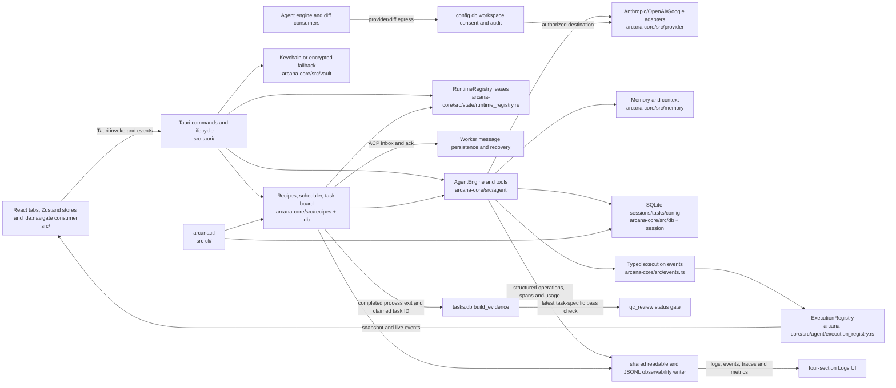

# Arcana codebase map (refreshed 2026-10-14; P4 implementation in progress)

Current phase boundary: P4 proves the Windows PA → Fleet coding path,
including safe manual Supervisor recovery and full Windows observability
breadth. P7-19 owns automatic process-loss replay/reassignment; P9-16 owns
Linux/macOS Fleet toolchain, sandbox, dependency, timestamp and worker parity.
Unsupported platform execution stays fail-closed (ADR-LOG-RESTRUCT-0391).
S4-01 now requires the Windows end-to-end task and build-verified artifact;
the equivalent Linux/macOS worker smoke is P9-16/TG9-06. The built desktop's
agent `WriteFileTool` → Tauri `ide:navigate` → IDE tab → validated sandboxed
Cargo Run → renderer output path passed the isolated P4-21 receipt. The
Windows Node `.cmd` path also passes a focused production IDE Run with a denied
sibling-file read. The complete P4-11/TG4-09 Windows command and containment
corpus remains open.
P4-11 now has isolated selected-workspace Build/Test exits for all three
checked-in Rust, npm/Node and Python fixtures through the production resolver
and sandbox. Registered `project_command` receipts connect the launcher to
worker calls. TG4-18 retains Lint/Run and the complete Windows corpus;
TG4-31 retains strict confinement/dependency staging.
The remaining TG4-18 Windows command failure is isolated to Cargo Clippy
configuration path canonicalization: Rust Run and npm Lint/Run also pass the
production sandbox. See `_verify/P4-18-WINDOWS-INTENT-ISOLATION-2026-10-14.md`.
The scheduler's in-process timeout recovery now has a real `kick("supervisor")`
consumer receipt: persisted Supervisor recipe → RecipeRunner → AgentEngine →
registered health/task tools → next model turn. Together with the prior
panic/lost-acknowledgement manual-continuation proof, this closes P4-36/S4-03;
P4-53/TG4-27 and P4-54/TG4-28 retain their wider contracts.
The separate-process P4-53 receipt follows worker claim/run binding →
`ToolExecutor`/`WriteFileTool` → failed journal outcome → process exit →
reopened `RunsDb`/`TasksDb`/checkpoint readers → exact-owner recovery and held
task. It proves quarantine across process loss; manual restarted-host handoff
and restore remain open.
The Windows P4-57/TG4-19 timestamp writer/reader corpus and legacy public
reader checks are recorded in
`_verify/P4-57-WINDOWS-CLOSEOUT-2026-10-13.md`; Linux/macOS execution remains
in P9-16/TG9-06.

Interactive turns hold runtime leases inside the spawned task; recipe and
subagent runs hold them for their run-function scope. ToolExecutor publishes
typed start/finish events, the execution registry exposes the active snapshot,
and the desktop chat store merges that snapshot with events during reconnect.
The Python orchestrator/memory sidecars are absent after P8; the PD0 Node
reference was retired under ADR-0043. The graph implementation is in
`arcana-core/src/graph`, with its eventual context read path still part of the
open P5 proof work.

`CoreRuntimeOptions` carries host prompt availability into `RecipeRunner`,
`AgentEngine`, and `ToolExecutor`. The desktop has a live permission responder;
the headless CLI marks it unavailable, so one-call `HostApproval` effects are
refused before a pending request or tool handler is created. CLI Fleet still
fails closed on dependency installation until locked host-controlled staging
exists.

P4-50 observability crosses `arcana-core/src/observability/` producers and the
shared `arcana-core/src/observability/logging.rs` writer. Its private
`telemetry_labels.rs` catalogue preserves exact registered operation/event labels
after generic redaction; unknown values and sensitive fields remain redacted. The Tauri module
`src-tauri/src/logging.rs` is now a compatibility re-export; the CLI and desktop
write the same daily readable and structured files consumed by
`src-tauri/src/commands/log_commands.rs` and `src/tabs/Logs.tsx`. Provider/model
metrics, outcomes, SQLite timing, memory timers, trace ancestry, and bounded
full-date export are implemented to varying depths. AgentEngine also writes
bounded `api_failures` records for calls with failed provider attempts, and the
existing AnalyticsQueries reader calculates retry outcomes from those rows;
provider response bodies are excluded. The four-section UI now
shows structured-tail truncation and provider/model call summaries. The CLI
exposes `arcanactl fleet run` and uses `arcana-core/src/runtime.rs` plus the
production recipe scheduler. These are implementation facts, not closeout
proof: production CLI success/recovery, event-to-Tauri-to-React behavior,
complete memory/database coverage, storage/export failure isolation, privacy
negatives, and reproducible overhead measurements remain open under P4-50 and
TG4-24.

P4 audit follow-up: ACP delivery must be durable at-least-once until ack, with
idempotent consumer handling keyed by stable message ID (ADR-0070). The
workspace egress consent is stored in `config.db` and read by production
provider and diff paths; Settings exposes explicit grant/revoke by canonical
workspace and provider. Arcana-mediated egress is denied without active consent
and decisions are audited (ADR-0068/0073). Free-form shell network activity is
outside this app-mediated boundary. End-to-end QC and direct Tauri diff tests
remain open. Worker identity and state resolve from a file-backed workers DB,
while `RecipeScheduler` loads the bound recipe prompt; the P4-30 consumer test
proves customization survives initialization and reaches that scheduler
resolver. Fleet workers opt into procedural recall at the AgentEngine boundary;
only a matching tool batch reaches the next provider request, with other runs
remaining off by default (P4-44). Checkpoint rows now include nullable
`task_id` alongside session and file path; P4-19/20 still needs task-wide
reversibility and stale-restore behavior proof.

The fleet dispatch path now wakes workers from task/message events and uses
per-worker five-minute recovery schedules only when recoverable work exists.
Transient worker-status DB failures retain the schedule. Push-run timeout and
RAII cleanup release still-owned claims, reset interrupted worker status, and
wake the Supervisor to route recovered work. Autonomous completion also wakes
the Supervisor after dependencies become ready. Full scheduler and fleet
smokes remain open.

Recovery catches panics/timeouts inside guarded worker futures and keeps a
worker marked `working` if task-claim release fails, so the scheduled recovery
pass can retry rather than hide an in-progress claim. A test runs a real
RecipeRunner on the next tick after timeout. The persistent `qc-agent` worker
uses `qc-dispatcher`; its shipped recipe consumes inbox-only work through
AgentEngine. QC diff analysis checks the shared workspace/destination consent
store before loading a provider key, using structural analysis without
matching consent. Automatic worker redispatch after a stale-mail nudge, full consent consumer coverage,
and fleet smokes remain open.

Build verification is wired through the registered `project_command` tool:
default worker recipes request explicit install/build/test/lint intents, Rust
resolves the selected ecosystem's argv, bounds output, and records task-scoped
evidence read by the QC status gate. Rust/Node multi-ecosystem selection and
ancestor fallback have focused tests. P4-13's observed process result and
shipped QC-reader proof pass. P4-14/TG4-07 now close on task-scoped atomic
batch evidence, direct-SQL and shared-transition enforcement, interrupted
batch refusal and actual PowerShell/`cmd` exit results; see
`_verify/P4-14-QC-NAMED-CLOSEOUT-2026-10-13.md`. P4-12 is closed by the
file-backed evidence/reopen/QC-reader proof. P4-11 and P4-61 retain the
Windows production command corpus, sandbox and full desktop worker-to-QC
smoke. Bash remains available for general shell work but cannot create build
evidence.

Graph-driven IDE navigation emits `ide:navigate` from the Tauri host. The
app-root listener in `src/utils/ideNavigation.ts` validates the workspace path,
then calls `useIdeStore.revealFile` to expand parent folders and open the file
and line. The event consumer and store reveal behavior have frontend tests;
the full artifact-to-run handoff is still open under P4-21/TG4-09.

Arcana's product-level control split is: Rust-owned mechanisms perform
deterministic project/tool discovery, command construction, permissions,
task lifecycle, evidence and recovery; the model plans, writes code and
exercises judgment. Built-in worker recipes should make a useful coding team
available without user-authored agent scaffolding. Every capability needs a
real production consumer and behavior proof. Cross-phase P1/P2/P3/P4/P8 audit
findings and current dispositions are recorded in
`_verify/2026-09-27-CROSS-PHASE-HARNESS-AUDIT.md`; P4 closeout gates remain
open until their production-path proofs pass. P8 host commit safety has passed
current-tree TG8-13/S8-06 and concurrency/binary-content tests after audit
hardening; this final hardening was verified and pushed on 2026-10-03. Its Bash control is a
textual heuristic with a documented process-sandbox limit.

Windows `project_command` Python intents route through
`platform::python_runtime` before entering `process_sandbox::windows`: the
selected CPython runtime and pytest closure are staged into Arcana-owned
storage, then exposed read-only to the workspace AppContainer. Production
Python Build/Test and sibling/read-write/network denial checks pass on the
current Windows host; fallback selection and Linux/macOS runtime confinement
remain open.

Shared SQLite opening/migration path: `db::open_tuned` retries only journal-mode lock failures within its five-second budget; `migrate::ensure_columns` reserves a writer for standalone legacy repairs; `migrate::run_ladder` reserves/rechecks each rung and retains per-rung transactions. Destructive rungs snapshot committed pre-change data through a separate read-only connection; automatic backup names are unique. Seven-opener and real desktop-startup proof: ADR-0276 and `_verify/P4-55-RETENTION-CLOSEOUT-2026-10-04.md`.
