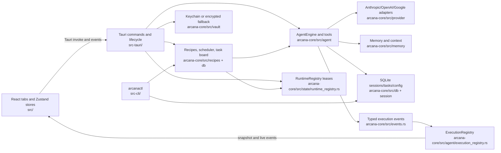

# Arcana codebase map (verified 2026-09-24)

Interactive turns hold runtime leases inside the spawned task; recipe and
subagent runs hold them for their run-function scope. ToolExecutor publishes
typed start/finish events, the execution registry exposes the active snapshot,
and the desktop chat store merges that snapshot with events during reconnect.
The Python orchestrator/memory sidecars are absent after P8; the PD0 Node
reference was retired under ADR-0043. The graph implementation is in
`arcana-core/src/graph`, with its eventual context read path still part of the
open P5 proof work.
